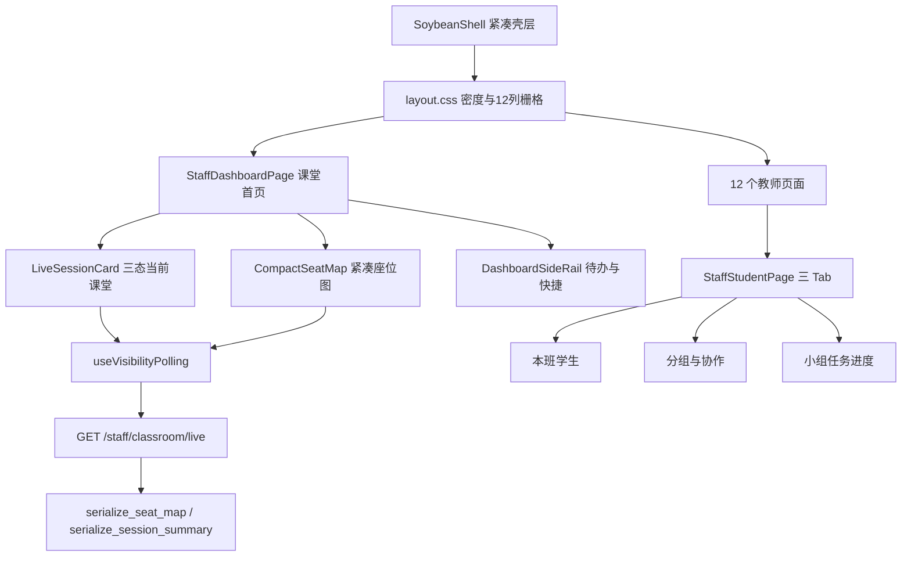

## 用户需求

1. **额外构造 3 种配色**供选择，与现有配色并列，可在界面设置中切换。
2. **教师后台整体布局过于分散**：留白太多、页面下滑太深（内容高度过高），需要整理成更聚焦的布局。
3. **教师后台仪表盘是课堂的首页**，需要真正围绕“教师上课时最关注的事情”来设计。

## 产品概述

把教师后台从“信息平铺的长页面”改造为**课堂驾驶舱**：进入后台第一眼就看到“此刻正在上的那节课”（哪个班、上到哪、来了几个人、谁没到、交到哪一步），次要但必要的信息（待批改、分组协作、最近记录）被收敛到明确的次要与从属位置，而不是在同一条纵列里继续往下堆。整体从“卡片大道”转为“紧凑栅格”，所有教师页面遵循同一套密度与栅格规则。

## 核心功能

- **6 套可切换配色**：在现有芒果冲浪、莓莓汽泡、电光霓虹之外，新增墨绿讲义、靛青石板、紫藤自习，每套同时具备浅色与深色两种形态。
- **紧凑骨架**：侧栏收窄、内容区限定最大宽度并按 12 列栅格排布，页面结构统一为“单行页头 + 主区 + 可选上下文右栏”；卡片圆角、间距、指标卡高度整体收紧。
- **课堂首页（仪表盘）**：以“当前课堂会话”为锚点，展示班级、学案、签到进度、未签到学生可点名、任务提交进度，并提供进入课堂控制或结束课堂的入口；没有进行中的课，则显示“上一次这节课”并给出已预选好班级与学案的一键开课。
- **座位状态**：紧凑座位图保留在首页主区，用色块区分未交、部分提交、已完成，一眼定位“谁还没登录、谁还没交”。
- **小组内容迁移**：小组协作（小组卡、共享文件、动态）、小组任务进度、分组维护整体迁到“学生名单”页，改为页内标签，首页只留一个跳转入口。
- **实时状态**：上课期间签到与提交状态按固定节奏自动刷新，切到后台即暂停，同时保留手动刷新。
- **全站统一重排**：教师后台 13 个导航项对应全部页面按同一骨架重排，并消除仪表盘与课堂控制页重复的“开课”表单。

## 视觉预期

第一屏即可看清课堂实况，无需滚动；同一屏内可并排看到“课堂状态”与“今天必须处理的待办”。整页留白收紧但不拥挤，卡片更矮更宽、信息更密，投影与教室大屏下文字与数字依然清晰可读。

## 技术栈

沿用现有技术栈，不新增依赖：

- 前端：Vue 3.5 + TypeScript + Vite 6 + **naive-ui** + Pinia + Vue Router + ECharts（`AppChart.vue` 封装）
- 后端：FastAPI + SQLAlchemy + SQLite（`apps/api`），pytest 验证
- 样式：纯 CSS 变量体系（`styles/theme.css` + `styles/base.css`），无 CSS 框架
- **硬性约束**：`apps/web/scripts/check-no-element.mjs` 禁止 Element Plus 与 `el-*` 组件；`check:mirror-js` 禁止与 `.ts` 同基名的 `.js` 副本；不引入 vitest/playwright 等新工具

## 实现方案

### 总体策略

分三层落地，先立规则再改页面：

1. **设计词法层**：新增 `styles/layout.css`，把密度与栅格做成 CSS 变量和工具类（`--ls-gap-*`、`--ls-radius-*`、`--ls-card-h`、`.ls-grid` / `.ls-span-4|6|8|12` / `.ls-page`）。13 个页面只消费变量，不再各自决定卡片多宽、留多少白。这是本次“更聚焦”的结构性解法，而不是逐页调字号。
2. **仪表盘信息架构层**：把“当前课堂”抽成独立组件（`LiveSessionCard`），座位图抽成 `CompactSeatMap`，待办与快捷入口抽成右栏；小组三块原样迁到学生名单页的 `GroupCollabPanel` / `GroupTaskProgressPanel` / `GroupManagerDrawer`。原 `StaffDashboardPage.vue` 从 2636 行降到结构清晰的多组件组合。
3. **实时数据层**：后端新增轻量接口，前端抽 `useVisibilityPolling` composable。

### 关键决策与权衡

**决策一：新增轻量实时接口，而不是轮询 `/staff/dashboard`。**
`GET /staff/dashboard`（`staff.py:1726`）每次都要加载全部可访问班级的学生、全部 `StudentLessonPlanProgress`、全部 `Submission`、全部 `ClassroomSession`（:1734-1843），复杂度是全校量级；10s 轮询会把 SQLite 单进程压满。新接口 `GET /staff/classroom/live?class_id=` 把范围收窄到**一个班 + 今天 + 当前学案**，复杂度 O(该班学生数 + 该班学案的提交数)，与全校规模无关。dashboard 仍只在进页面时加载一次，二者职责分离、互不重复计算。

**决策二：复用现有序列化函数，不重写组装逻辑。**
`serialize_seat_map(school_class, checked_in_at_by_student, checked_in_record_by_seat_id, student_submission_summary_by_id, plan_submission_summary_by_student, focus_plan_id=...)`（`staff.py:448`）与 `serialize_session_summary`（:374）、`build_student_submission_summaries`（:294）已能产出所需结构，新接口只是按单班范围调用它们。这样“仪表盘、课堂控制页”和“实时接口”三处的口径天然一致，避免出现两套签到/提交语义。鉴权复用 `staff_can_access_class`（与 `seat-map` :2839 相同的 403 语义）。

**决策三：把仪表盘锚点做成三态组件，而不是加条件判断片段。**
`LiveSessionCard` 内部区分“进行中会话 / 有上次那节课 / 完全无记录”三态，三态共用同一套布局骨架（左：班级与学案；中：签到环形进度 + 未签到名单；右：提交进度 + 主操作按钮）。无会话态下把 `launchpad.classes` 与 `ready_plans` 的默认值（`launchpad.default_class_id` / `default_plan_id`）预选，实现“一键开课”。三态抽在一个组件里，避免模板里散落 `v-if` 导致下次维护又变回长页面。

**决策四：小组三块整块搬迁，不重写业务。**
`/classes/{id}/groups`、`group-task-progress`、`group-management`、`group-operation-logs`、`drive/files/{id}` 的调用与 `apiGetBlob` 鉴权下载逻辑原样搬入 `StaffStudentPage.vue` 的标签页，只改承载容器与样式，不改请求与数据处理。这是把 800 行模板挪位置、而不是重写 800 行逻辑，是本次最大的风险控制点。

**决策五：主题增量而非替换。**
每套新主题 = 1 个浅色变量块（约 55 个变量）+ 1 个深色覆盖块（约 15 个变量）+ `themes.ts` 一项 + `ThemeDrawer.vue` 的 `swatchMap` 一项。图表颜色已全部走 `readThemeToken()`（`utils/themeTokens.ts`，`StaffDashboardPage.vue:1494-1498` 已如此），因此新增主题**不需要改任何图表代码**，只需保证 6 主题 × 2 模式下的对比度。

### 性能与可靠性

- 实时接口：单次查询限定 1 个班；`AttendanceRecord` 按 `class_id + attendance_date == today` 过滤，`Submission` 通过该班当前学案的 task 集合过滤；单次返回体控制在数 KB 级。
- 轮询：10s 间隔；`document.hidden` 时停机；不重叠请求（in-flight 标记）；失败指数退避至 60s 上限；组件卸载必须 `clearTimeout` + `AbortController.abort()`，避免离开页面后仍在打接口。
- 首屏：`GET /staff/dashboard` 仍是唯一首屏请求，实时接口只做增量覆盖（只替换签到与提交相关字段），不触发整页重渲染。
- 无新增依赖，打包体积不增加（反而因删除 ECharts 两处图表配置略微减小）。

## 实施要点

- **不改业务语义**：13 个页面重排只动模板结构与样式，保留全部 `ref`/`computed`/`function`/接口调用与轮询外的副作用；这样 typecheck 就是最有效的回归网。
- **复用现有骨架组件**：`components/sa/SaPageHeader.vue`、`SaPanel.vue`、`SaDataTable.vue`、`SaTableColumn.vue` 已统一了页头/面板/表格，重排时优先给它们加 `compact` 变体，而不是每页手写卡片。
- **侧栏折叠值联动**：`SoybeanShell.vue` 折叠宽 72 改为 64、展开 236 改为 200 时，`navTabs` 折叠状态与 960px 断点逻辑（:582）必须同步，否则窄屏会闪。
- **深色模式正交性**：`data-theme` 与 `data-scheme` 两个维度相乘，新增主题必须补齐 `:root[data-scheme='dark'][data-theme='xxx']` 覆盖块，否则深色下会沿用旧主色高亮（现有 `theme.css:293-346` 就是为此存在）。
- **错误处理**：前端沿用现有 `errorMessage` + `n-alert` 模式，不引入新日志库、不 `console.log` 轮询细节（只在轮询连续失败时提示一次）；后端沿用既有 `HTTPException` 语义，不输出学生姓名等 PII 到日志。
- **影响面控制**：不动学生端、登录页、`auth`/`api/http.ts`；不做 git 提交；工作区已有的未提交改动（上一轮 P2/P3）不得回退。
- **每批验收口径**：`npm run typecheck:web`、`npm run check:no-element`、`npm run build:web`、`apps\api\.venv\Scripts\python.exe -m pytest apps/api/tests -q`（基线 76 passed / 5 failed，失败数不得增加），并用 Chrome CDP 对关键页截图（教师 `t1 / 222221`）。

## 架构设计



## 目录结构

```
apps/web/src/
├── main.ts                                          # [MODIFY] 追加 import './styles/layout.css'（在 base.css 之后，保证密度变量可覆盖旧值）
├── styles/
│   ├── layout.css                                   # [NEW] 密度与栅格词法层。定义 --ls-gap-xs/sm/md/lg（6/10/14/18）、--ls-radius-sm/md/lg（10/14/18）、--ls-card-pad（14）、--ls-card-h-sm（88）、--ls-content-max（1680）；提供 .ls-page（12 列栅格容器）、.ls-main（8 列）、.ls-rail（4 列）、.ls-row（自适应指标条）、.ls-stack（纵向 12px 间距）；在 1600/1100/760px 三档断点做栅格塌陷
│   ├── base.css                                     # [MODIFY] .page-stack gap 18→12；.hero-panel padding 24→16 且改为单行紧凑布局；.soft-card 圆角 20→14；.page-content gap 14→12；.metric-grid 由 auto-fit minmax(180px,1fr) 改为固定 4 列栅格（窄屏 2 列/1 列）；.metric-tile padding 18→14、圆角 18→14、min-height 88、.metric-value 字号下调
│   ├── theme.css                                    # [MODIFY] 在 neon-pulse 之后、深色基座之前新增 3 个浅色主题块；在现有深色覆盖块之后新增 3 个 :root[data-scheme='dark'][data-theme='...'] 覆盖块。必须保证同权重后出现者生效
├── utils/
│   └── themes.ts                                    # [MODIFY] themeOptions 增至 6 项（顺序：现有 3 套在前，新增 3 套在后）；defaultTheme 保持 'mango-splash'
├── layouts/
│   ├── shared/
│   │   ├── SoybeanShell.vue                         # [MODIFY] .sb-aside 236→200、折叠 72→64、.sb-brand 字号随之下调；.sb-header 高度 56→52；.sb-tabs 内边距压缩；.sb-content padding 16/20/32→12/16/24 且外层包裹 .ls-page（max-width 1680 + margin 0 auto）；960px 断点同步
│   │   └── ThemeDrawer.vue                          # [MODIFY] swatchMap 增加 3 个新色卡渐变；主题列表改为 2 列网格卡片（6 项时单列过高）
│   └── staff/
│       └── StaffLayout.vue                          # [MODIFY] navGroups 保持 13 项不变；仅补充导航项 hover/active 在窄侧栏（200px）下的文字截断处理；staffPageItems 不变
├── components/sa/
│   ├── SaPageHeader.vue                             # [MODIFY] 新增 compact 属性：单行布局（eyebrow 与标题同行、description 收为一行省略号 + tooltip）、padding 降至 16，默认仍为旧样式以兼容学生端以外的调用
│   └── SaPanel.vue                                  # [MODIFY] 新增 compact 属性：head padding 18/20/14→12/14/10、body padding 20→14、标题字号 15→14
├── composables/
│   └── useVisibilityPolling.ts                      # [NEW] 可见性感知轮询：入参 { fetcher, intervalMs, enabled, immediate }；内部 document.visibilitychange 暂停/恢复、in-flight 去重、AbortController 取消、失败指数退避（10s→20s→40s→60s 封顶）、连续失败计数回抛给调用方、onBeforeUnmount 清理
├── modules/staff-dashboard/
│   ├── StaffDashboardPage.vue                       # [MODIFY] 结构重写为：compact 页头 + 栅格（主区 8 列：LiveSessionCard、CompactSeatMap；右栏 4 列：DashboardSideRail）。删除 2 张 ECharts 图与页尾重复指标组（原 :46-71、:594-615）、删除开课表单与课堂预览（原 :73-121，改由 LiveSessionCard 承担）、删除小组协作/小组任务进度/分组维护（原 :206-591、:659-977）；保留 loadDashboard 与全部数据类型
│   ├── components/
│   │   ├── LiveSessionCard.vue                      # [NEW] 三态当前课堂卡：进行中/上次那节课/无记录。左列班级+学案+时间；中列签到 n/N 环形进度、未签到学生 chip 列表（点击弹出点名清单）；右列提交进度（完成/部分/未交）与主操作（进入课堂控制/结束课堂/一键开课）。消费 useVisibilityPolling 的实时数据增量覆盖
│   │   ├── CompactSeatMap.vue                       # [NEW] 紧凑座位图：格子高 56px、座位号+姓名+IP 三级信息，右下角 6px 色点表达未交/部分/完成，签到中高亮描边；顶部只保留一行图例与班级切换
│   │   └── DashboardSideRail.vue                    # [NEW] 右栏：今日待办（待评阅/推荐作品/待签到，点击跳转对应页）、快捷入口（学案管理/提交批改/学生名单/课堂控制）、最近 3 条课堂记录
├── modules/staff-student/
│   ├── StaffStudentPage.vue                          # [MODIFY] 顶部保留班级选择器与 4 个指标；主体改为 n-tabs 三标签：本班学生（现有表格与批量操作）、分组与协作、小组任务进度；新增“分组维护”按钮打开 GroupManagerDrawer
│   └── components/
│       ├── GroupCollabPanel.vue                      # [NEW] 迁移原仪表盘小组协作（小组卡、共享文件列表、成员条、动态流）。保留 /classes/{id}/groups 与 drive 文件下载（apiGetBlob）逻辑原样
│       ├── GroupTaskProgressPanel.vue                # [NEW] 迁移原仪表盘小组任务进度（总体概览、每组进度条、任务矩阵）。保留 /classes/{id}/plans/{planId}/group-task-progress 调用
│       └── GroupManagerDrawer.vue                    # [NEW] 迁移原 78% 分组维护抽屉（一键重组、追溯记录、小组配置、成员分配）。保留 groups POST、rebuild、PUT group-management、group-operation-logs 查询与导出
├── modules/staff-classroom/ClassroomPage.vue         # [MODIFY] 按新骨架重排：compact 页头 + 主区（当前会话详情、开课设置）+ 右栏（活跃会话列表）；接入 useVisibilityPolling 复用实时接口；消除与仪表盘重复的开课表单视觉
├── modules/staff-lesson-plan/LessonPlanPage.vue      # [MODIFY] 三栏（列表/编辑/预览）改为新栅格，左列表收窄至 280px、编辑区占 8 列、预览折叠为可开合右栏；不改编辑器逻辑
├── modules/staff-submission/SubmissionOverviewPage.vue # [MODIFY] 指标条 + 任务列表改为新栅格，右侧增加“待批改队列”上下文栏
├── modules/staff-submission/SubmissionTaskPage.vue   # [MODIFY] 作品列表与详情改为左列表 + 右详情两栏（不再上下堆），批改操作栏固定在右栏顶部
├── modules/staff-curriculum/StaffCurriculumPage.vue  # [MODIFY] 教材/单元/课时改为左侧树 + 右侧详情两栏
├── modules/staff-quiz/StaffQuizPage.vue              # [MODIFY] 题库列表与题目编辑改为两栏；分页与搜索保持现有服务端分页逻辑
├── modules/staff-typing/StaffTypingPage.vue          # [MODIFY] 榜单与统计改为左右两栏，指标条压缩为一行
├── modules/staff-resource/StaffResourcePage.vue      # [MODIFY] 资源网格密度提升（每行 4→6 项），筛选条收为单行
├── modules/staff-assistant/StaffAssistantPage.vue    # [MODIFY] 助手列表左栏 + 配置右栏
├── modules/staff-attendance/StaffAttendancePage.vue  # [MODIFY] 班级/日期筛选收为单行，表格改用 SaDataTable small 尺寸，右侧增加当日出勤摘要栏
├── modules/staff-report/StaffLearningReportPage.vue  # [MODIFY] 报告列表 + 报告详情两栏，生成入口收进页头操作区
├── modules/staff-admin/AdminSystemPage.vue           # [MODIFY] 现有左侧二级导航 + 内容区改为 3 列栅格（二级导航 2 列宽、内容 10 列宽），各设置分区按卡片分组；三个路由（system/ai-providers/ai-safety）共用同一骨架

apps/api/
├── app/api/v1/endpoints/staff.py                     # [MODIFY] 新增 GET /staff/classroom/live：入参 class_id，先 staff_can_access_class 校验（403），再查该班今日 AttendanceRecord、该班最后一次会话、该班当前学案的 submissions，复用 serialize_seat_map / serialize_session_summary / build_student_submission_summaries 组装轻量响应
└── tests/test_staff_classroom_live.py                # [NEW] 覆盖：无权限 403、无会话时 session 为 null、有会话时签到数与未签到名单正确、提交阶段三分档正确、班级无学生/无学案时的空态

docs/visual-regression/2026-10-27/README.md           # [NEW] 本轮视觉验收基线：6 套主题浅/深截图清单、仪表盘三态截图、学生名单三 Tab 截图、验收清单
```

## 关键接口契约

前端 `ClassLivePayload` 类型（新接口响应 `data` 字段，两个消费方共用）：

```ts
type LiveStudent = {
  user_id: number;
  display_name: string;
  student_no: string;
  seat_label: string | null;
  signed_in_at: string | null;
  submission_stage: 'none' | 'partial' | 'completed';
};

type ClassLiveSession = {
  session_id: number;
  status: 'active' | 'ended';
  started_at: string;
  class_id: number;
  class_name: string;
  plan_id: number | null;
  plan_title: string | null;
};

type ClassLivePayload = {
  session: ClassLiveSession | null;
  attendance: {
    student_count: number;
    checked_in_count: number;
    pending_signin_count: number;
    pending_students: LiveStudent[];
  };
  submission: {
    task_count: number;
    completed_student_count: number;
    partial_student_count: number;
    none_student_count: number;
    submitted_count: number;
    pending_review_count: number;
  };
  students: LiveStudent[];
  generated_at: string;
};
```

## 设计风格

**课堂驾驶舱（Classroom Cockpit）**：高信息密度、主次分明、克制而精确。不做装饰性留白，每一块空间都承载可执行的信息；视觉重心从“漂亮的卡片墙”转为“一眼看懂的课堂实况”。

## 布局体系

- **壳层**：侧栏 200px（折叠 64px）、顶栏 52px、多标签栏 34px；内容区 `max-width: 1680px` 居中，padding 12/16/24。
- **栅格**：内容区统一 12 列（列间距 12px）。页面 = 单行页头（全宽）+ 主区（8 列）+ 可选上下文右栏（4 列）。断点：≥1600px 主区右栏并列；1100–1600px 右栏下移为主区下方两列；<1100px 单列；<960px 侧栏自动折叠。
- **密度基准**：卡片圆角 14px、内边距 14px、卡片间纵向间距 12px、指标卡固定高 88px、表格 `size="small"`、页头压缩为单行（标题 + 一行描述 + 右侧操作）。

## 页面规划

### 1. 仪表盘（课堂首页）

- **页头**：单行。左侧“教师工作台 · 姓名 + 角色标签”，右侧仅保留“课堂控制”主按钮与“刷新”。
- **当前课堂卡（主区顶部，视觉最强）**：左列班级名 + 学案标题 + 开课时间；中列签到环形进度（n/N，主色描边）+ 未签到学生 chip 列表（点击展开点名清单）；右列提交进度三分档条 + 主操作按钮（进入课堂控制 / 结束课堂）。三态切换时只换文案与按钮，不换骨架。
- **紧凑座位图（主区）**：格子 4–8 列自适应，每格显示座位号、姓名、右下角色点（灰=未交、琥珀=部分、主色=完成），已签到格加 1px 主色描边。顶部一行图例与班级切换。
- **右栏**：今日待办（待评阅 / 推荐作品 / 待签到，均可点击跳转）、快捷入口（学案管理 / 提交批改 / 学生名单）、最近 3 条课堂记录（紧凑列表，两端对齐时间与状态）。
- **删除项**：两张 ECharts 大图、页尾重复指标组、开课表单、小组协作、小组任务进度、分组维护。

### 2. 学生名单（承载班级台账）

- 页头保留班级选择器与 4 个紧凑指标（学生数 / 活跃 / 停用 / 已分组）。
- 页内三标签：**本班学生**（现有表格 + 批量操作）、**分组与协作**（小组卡网格 3 列 + 右侧共享文件与动态；文件项显示上传者与时间）、**小组任务进度**（顶部总体进度条 + 每组一行三段进度 + 任务矩阵表）。
- “分组维护”按钮固定在页头右侧，打开 78% 抽屉（内容原样迁移，仅按新密度调整内边距）。

### 3. 课堂控制

- 主区：当前会话详情（学案、班级、开课时间、任务数、签到/提交实时数字，10s 刷新且有“更新于 x 秒前”提示）。
- 右栏：开课设置（班级 + 学案 + 一键开始）与活跃会话列表。

## 视觉语言

- **卡片**：白底、1px 边框（`--ls-border`）、极轻阴影，取消大圆角与强投影；同级卡片圆角、边框、内边距严格一致。
- **分隔**：优先用 1px 细线与 12px 间距划分层级，减少“一张卡套一张卡”。
- **数字优先**：指标数字用等宽感更强的字重（650）与 26px 字号，标题文案降为 12px 次级灰，形成“数字大、标签小”的扫读节奏。
- **状态色**：未交灰、部分琥珀、完成主色；签到用主色描边而非大面积填色，避免整屏噪点。
- **动效**：卡片 hover 上浮 2px、120ms；轮询更新时数字做 200ms 数字微闪（`opacity` 0.6→1），不整块闪烁；骨架屏仅在首屏加载使用。

## 交互与响应式

- 轮询期间页头显示“更新于 x 秒前”，切到后台自动暂停并显示“已暂停”；手动刷新与自动轮询共用同一请求去重。
- 座位图与名单在窄屏（<1100px）退化为两列/一列，右栏内容自动落到主区下方。
- 所有跳转用 `router.push`，不在新标签页打开，保持标签栏（`navTabs`）语义一致。

## Agent Extensions

### SubAgent

- **code-explorer**
- Purpose: 批量盘点 13 个教师页面（AdminSystemPage 3205 行、SubmissionTaskPage 2559 行、LessonPlanPage 2457 行等）现有的区块划分、栅格类名、可复用组件边界，输出每页的“区块清单 + 需要改动的模板行区间”，避免在改大文件时盲目全文阅读。
- Expected outcome: 得到一份逐页重构清单（页面 → 区块 → 目标栏位 → 改动点），作为批 3 重排的执行依据，且明确哪些 `ref`/`computed`/请求逻辑必须保持不动。